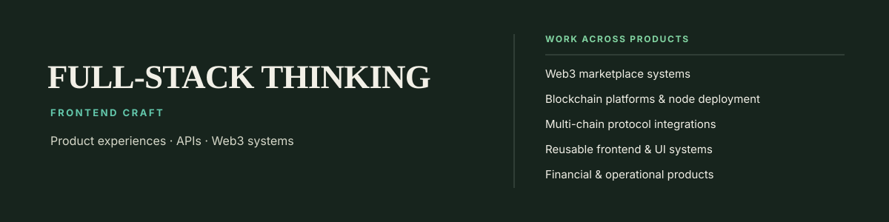
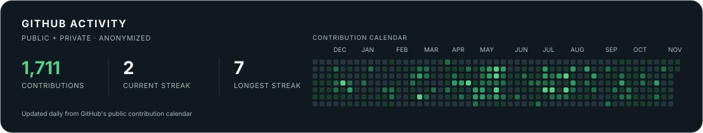

 

# Hi, I'm Gowrish 👋

### Full Stack Developer at Zeeve

*Frontend roots. Full-stack perspective. Web3 product work.*

[Explore my repositories](https://github.com/gowrishZeeve?tab=repositories)

---

## A little about me

I started out as a junior frontend developer and grew into full-stack development. Today, I contribute across product interfaces, backend services, and the systems that bring Web3 market experiences together.

My frontend background shapes how I approach the whole product: start with the user experience, then follow the problem through the APIs and services behind it.

## What I work on

### Product experiences

Building and refining consumer and admin workflows—from event discovery and prediction flows to onboarding and operational tools.

### Application services

Contributing to TypeScript APIs and product services, including identity and integration flows, background jobs, and real-time features.

### Market systems

Working across live ranking, settlement, and validation services that connect market activity to reliable outcomes.

## Technologies

**Frontend — my core**

  
  
  
  
  

**Backend & systems — supporting experience**

  
  
  
  
  
  

## GitHub activity

  <picture>
    <source media="(prefers-color-scheme: dark)" srcset="./assets/activity-stats-dark.svg" />
    <source media="(prefers-color-scheme: light)" srcset="./assets/activity-stats-light.svg" />
    
  </picture>

Public and private activity appears only as anonymous contribution totals and streaks when private contributions are enabled on GitHub.

---

*Thanks for stopping by. Feel free to explore my repositories and follow along as I build.*

